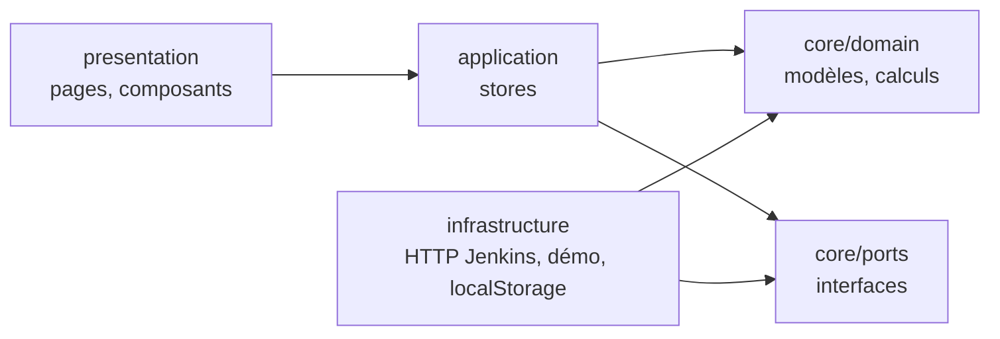
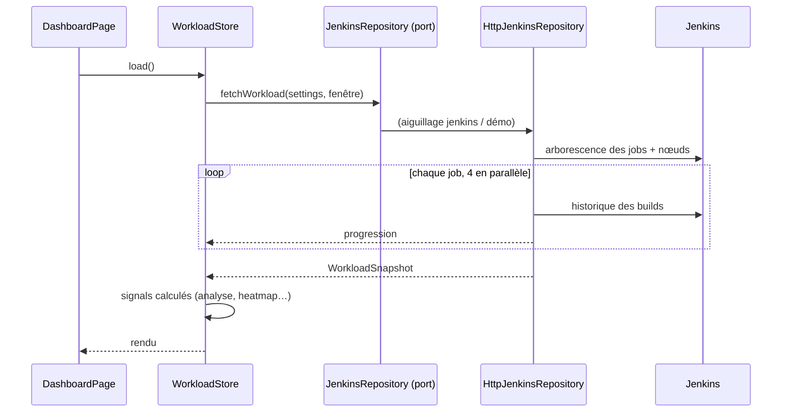
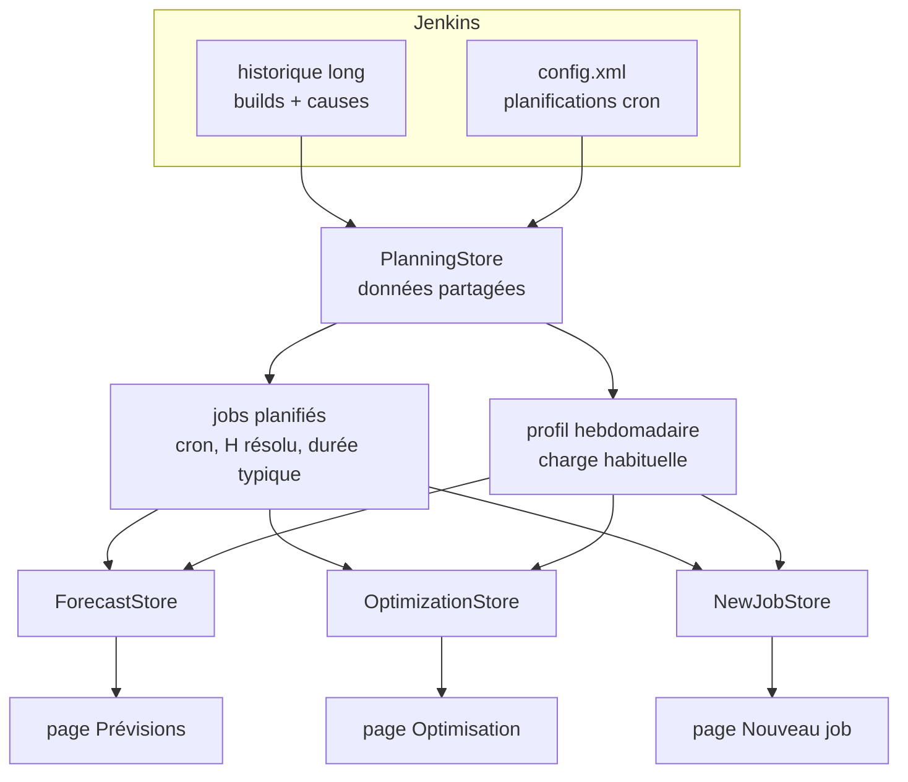

# Architecture et choix techniques

## Vue d'ensemble

L'application suit une **clean architecture** : le code est rangé en couches concentriques, et
les dépendances pointent toujours vers le centre, c'est-à-dire vers le domaine.

| Couche | Dossier | Contient | Peut dépendre de |
| --- | --- | --- | --- |
| Domaine | `core/domain` | Modèles (`Build`, `TimeWindow`…) et calculs purs | rien (ni Angular, ni RxJS) |
| Ports | `core/ports` | Classes abstraites `JenkinsRepository`, `SettingsRepository` | domaine |
| Application | `application` | Stores : état de l'écran, orchestration | domaine, ports |
| Infrastructure | `infrastructure` | Implémentations des ports | domaine, ports |
| Présentation | `presentation` | Pages, composants, formatage | application, domaine |

**Règle d'or** : un fichier de `core/domain` n'importe jamais rien d'Angular, de RxJS ou d'une
autre couche. Il ne fait que des calculs sur des données.

Les imports utilisent des alias (`tsconfig.json`) qui rendent la couche visible :
`@domain/…`, `@ports/…`, `@application/…`, `@infrastructure/…`, `@presentation/…`.

## Le flux d'un chargement

1. La page appelle `WorkloadStore.load()`.
2. Le store demande au **port** `JenkinsRepository` un `WorkloadSnapshot` pour la fenêtre choisie.
3. `RoutingJenkinsRepository` choisit l'implémentation selon les paramètres : HTTP ou démo.
4. L'implémentation HTTP interroge Jenkins, convertit les réponses en objets du domaine
   (`jenkins.mapper.ts`) et émet des événements de progression puis le snapshot.
5. Le store garde le snapshot dans un signal. Tout le reste (KPI, plages creuses, série de
   charge, heatmap, suggestions) est fait de **signals calculés** qui appellent les fonctions
   du domaine. Changer le filtre ou le zoom recalcule sans refaire d'appel réseau.

## L'orchestration des pages de planification

Prévisions, Optimisation et Nouveau job partagent les mêmes données, chargées **une seule fois**,
à la demande, par `PlanningStore`. Chaque page a ensuite un store fin qui ne fait qu'assembler
des fonctions du domaine.

- Ouvrir l'une des trois pages déclenche `ensureLoaded()` : historique (28 jours par défaut),
  puis lecture des `config.xml` des jobs découverts. Les deux autres pages réutilisent le résultat.
- Les calculs (prévision, optimisation, créneaux) sont des **signals calculés** : changer
  l'horizon, le décalage maximal ou la durée du nouveau job recalcule instantanément, sans appel
  réseau.
- Enregistrer les paramètres appelle `PlanningStore.reset()` : les données seront rechargées.
- Les calculs prennent pour « maintenant » l'instant du chargement : les résultats restent
  stables tant qu'on n'actualise pas.

## Les choix et leurs raisons

### Pas de backend

**Choix** : l'application appelle l'API Jenkins directement depuis le navigateur.
**Pourquoi** : c'était une demande explicite, et l'API Jenkins fournit déjà tout ce qu'il faut.
Rien à héberger, à sécuriser ou à maintenir en plus.
**Conséquence** : CORS doit être géré (proxy de dev, reverse proxy ou plugin). Le token reste
dans le navigateur de l'utilisateur ; il est conseillé d'utiliser un compte en lecture seule.

### Clean architecture

**Pourquoi** : la logique qui compte (trouver les plages creuses, proposer un créneau) est
indépendante d'Angular et de Jenkins. Isolée dans le domaine, elle est :
- **testable** sans navigateur ni serveur (fonctions pures, tests en millisecondes) ;
- **réutilisable** : on pourrait brancher GitLab CI ou un export CSV en écrivant un seul
  adaptateur ;
- **lisible** : chaque fichier a une responsabilité unique.

### Les ports sont des classes abstraites

**Pourquoi** : en Angular, une classe abstraite sert à la fois de type TypeScript et de jeton
d'injection. `inject(JenkinsRepository)` fonctionne sans `InjectionToken` supplémentaire.
Le branchement se fait en un seul endroit : `infrastructure/provide-infrastructure.ts`.

### Le mode démo est un adaptateur comme un autre

**Pourquoi** : il permet d'essayer l'outil, de développer l'interface sans Jenkins et de faire
des captures d'écran reproductibles (générateur pseudo-aléatoire déterministe). Comme il
implémente le même port, le reste de l'application ne sait pas qu'il est fictif.

### Signals plutôt que NgRx

**Pourquoi** : l'état est petit (un snapshot, une période, un filtre, un zoom). Les signals
d'Angular, avec `computed`, donnent un état réactif sans bibliothèque ni boilerplate. RxJS
n'est utilisé que là où il excelle : les requêtes HTTP (concurrence, retry, annulation via
`switchMap` quand on change de période en cours de chargement).

### Angular sans zone.js (zoneless), composants `OnPush`

**Pourquoi** : c'est le mode recommandé d'Angular 20 avec les signals. Le rendu ne se met à
jour que quand un signal change : c'est plus rapide et plus prévisible.

### Graphiques en SVG maison, sans bibliothèque

**Pourquoi** : la chronologie a des besoins précis (bandes de plages creuses, lignes de builds
empilées, zoom par glisser, clic vers Jenkins) qui demanderaient de toute façon de contourner
une bibliothèque de graphiques. Le SVG maison fait ≈ 250 lignes et ne pèse rien dans le bundle.
La heatmap est une simple grille CSS.

### Prévisions statistiques plutôt que « machine learning »

**Pourquoi** : la charge d'une CI est surtout saisonnière (journées, nuits, week-ends) et en
partie programmée (crons). Un profil hebdomadaire pondéré + la projection des crons capture
l'essentiel, reste explicable à toute l'équipe, tourne en millisecondes dans le navigateur, et
sa fiabilité est mesurée (rejeu sur la semaine passée). Détails : [planning.md](./planning.md).

### Optimisation par recherche locale

**Pourquoi** : le problème exact (placer N jobs pour minimiser les pics) est combinatoire, mais
les instances réelles sont petites (quelques dizaines de jobs, 672 quarts d'heure). Une recherche
locale gloutonne avec un coût quadratique donne de bonnes solutions en quelques millisecondes,
et chaque proposition reste compréhensible (« décaler ce job de +2 h »).

### Les planifications sont lues à la demande

**Pourquoi** : lire les `config.xml` coûte une requête par job et demande un droit
supplémentaire. Le tableau de bord n'en a pas besoin ; seules les pages de planification les
chargent, et un refus (403) dégrade proprement la fonctionnalité au lieu de la bloquer.

### Un lanceur sans dépendance pour la version installée

**Pourquoi** : un navigateur n'exécute pas une application Angular ouverte en `file://`, et
l'équipe veut une version à lancer depuis un NAS. `tools/launcher/serve.mjs` sert les fichiers et
relaie Jenkins, en Node.js pur (aucun `npm install` sur les postes). Ce n'est pas un backend :
aucune logique, aucune donnée. Le jour où l'application est hébergée, il disparaît.
Voir [Installation](./deployment.md).

### Réglages d'équipe dans `app-config.json`

**Pourquoi** : éviter que chacun ressaisisse l'URL de Jenkins et les options. Le fichier est lu
au démarrage (`provideAppInitializer`), filtré champ par champ (`settings-sanitizer.ts`), et
n'écrase jamais les choix de l'utilisateur ni ne contient d'identifiants.

### Temps en millisecondes epoch

**Pourquoi** : Jenkins renvoie des timestamps en ms. Garder des `number` partout simplifie les
calculs d'intervalles. La conversion en dates lisibles se fait uniquement dans
`presentation/shared/format.ts` (locale `fr-FR`, fuseau du navigateur).

### Algorithmes

- **Plages creuses** (`occupancy.ts`) : on fusionne les intervalles des builds, puis on prend
  le complément dans la fenêtre. Complexité O(n log n).
- **Série de charge** (`load-series.ts`) : balayage (*sweep line*) des événements début/fin
  triés ; à instant égal, les fins passent avant les débuts pour que deux builds enchaînés ne
  comptent pas comme simultanés. Un seul passage calcule la moyenne et le pic de chaque intervalle.
- **Lignes de la chronologie** (`lane-layout.ts`) : rangement glouton par ordre de début ; le
  nombre de lignes obtenu est égal au pic de concurrence (c'est optimal).
- **Créneaux de maintenance** (`weekly-heatmap.ts`) : fenêtre glissante circulaire sur les 168
  heures de la semaine type. Voir [Fonctionnalités](./features.md#comment-sont-trouvés-les-créneaux-de-maintenance).

## Carte des fichiers

| Fichier | Rôle |
| --- | --- |
| `core/domain/time-window.ts` | Intervalle de temps, constantes `MINUTE`, `HOUR`, `DAY` |
| `core/domain/build.ts` | Un build et son résultat |
| `core/domain/jenkins-settings.ts` | Paramètres et valeurs par défaut |
| `core/domain/workload-snapshot.ts` | Résultat d'un chargement |
| `core/domain/analytics/occupancy.ts` | Fusion d'intervalles, temps occupé, plages creuses |
| `core/domain/analytics/load-series.ts` | Charge moyenne et pic par intervalle |
| `core/domain/analytics/weekly-heatmap.ts` | Semaine type et créneaux de maintenance |
| `core/domain/analytics/job-stats.ts` | Statistiques par job |
| `core/domain/analytics/workload-analysis.ts` | Assemble les indicateurs d'une fenêtre |
| `core/domain/planning/jenkins-cron.ts` | Lecture des crons Jenkins (`H`, plages, pas, alias) et calcul des déclenchements |
| `core/domain/planning/scheduled-job.ts` | Jobs planifiés : résolution de `H` par l'historique, durée typique, exécutions à venir |
| `core/domain/planning/weekly-profile.ts` | Charge habituelle par quart d'heure de la semaine |
| `core/domain/planning/forecast.ts` | Prévision, fenêtres calmes / risques, rejeu de fiabilité |
| `core/domain/planning/load-grid.ts` | Semaine type circulaire et fonction de coût |
| `core/domain/planning/daily-pattern.ts` | Planifications déplaçables, décalage, réécriture en cron |
| `core/domain/planning/schedule-optimizer.ts` | Optimisation des planifications |
| `core/domain/planning/slot-finder.ts` | Meilleurs créneaux pour un nouveau job |
| `core/domain/planning/week-grid.ts` | Projection des jobs planifiés sur la semaine type |
| `core/ports/*.ts` | Contrats des sources de données |
| `application/workload.store.ts` | État du tableau de bord |
| `application/settings.store.ts` | Paramètres courants |
| `application/period.ts` | Périodes proposées |
| `application/planning.store.ts` | Données partagées des pages de planification (historique long, crons) |
| `application/forecast.store.ts`, `optimization.store.ts`, `new-job.store.ts` | Un store par fonctionnalité |
| `infrastructure/jenkins/jenkins-http.client.ts` | URL, auth, timeout, retries, erreurs |
| `infrastructure/jenkins/http-jenkins.repository.ts` | Stratégie de requêtes Jenkins |
| `infrastructure/jenkins/jenkins.mapper.ts` | Réponses Jenkins → objets du domaine (dont la cause des builds) |
| `infrastructure/jenkins/jenkins-config.parser.ts` | Extraction des crons d'un `config.xml` |
| `infrastructure/storage/http-team-config.repository.ts` | Lecture de `app-config.json` |
| `infrastructure/demo/demo-jenkins.repository.ts` | Données fictives |
| `infrastructure/routing-jenkins.repository.ts` | Aiguillage Jenkins / démo |
| `infrastructure/provide-infrastructure.ts` | Branchement des ports |
| `presentation/components/load-timeline/` | Chronologie SVG du tableau de bord |
| `presentation/components/weekly-heatmap/` | Carte de chaleur |
| `presentation/components/time-series-chart/` | Graphique générique des pages de planification |
| `presentation/components/stat-grid/` | Rangée d'indicateurs réutilisable |
| `presentation/components/planning-status/` | Provenance, chargement et avertissements des données de planification |
| `presentation/pages/forecast/`, `optimize/`, `new-job/` | Les trois pages de planification |
| `presentation/shared/chart/` | Graduations de temps et rangement en lignes, partagés par les graphiques |
| `presentation/shared/format.ts` | Formatage des durées et dates en français |
| `proxy.conf.mjs` | Proxy du serveur de dev vers Jenkins |
| `tools/launcher/serve.mjs` | Lanceur de la version installée (fichiers + relais Jenkins) |
| `tools/package.mjs` | Assemble la version installable (`npm run package`) |
